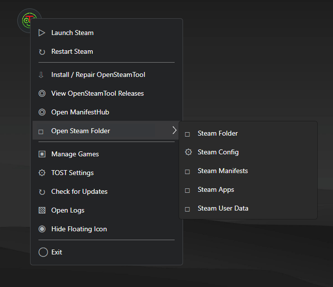
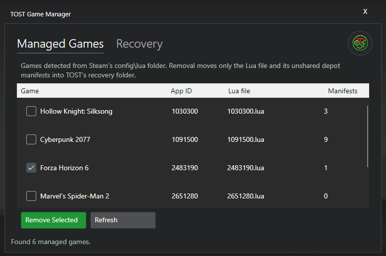
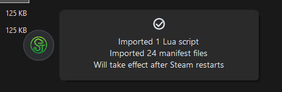

<div align="center">
  
  <h1>TOST</h1>
  <p>
    
    
    
  </p>
</div>

---

## What is TOST?

For a long time, the original **Steamtools** was popular for manifest sideloading, but it was closed-source, proprietary, and eventually abandoned.

The community created **OpenSteamTool** (and now the actively maintained **[BetterSteamTools](https://github.com/madoiscool/BetterSteamTools)** fork) to replace it with a transparent, open-source C++ engine. However, these tools are bare DLLs without a user interface—forcing people to manually extract files, edit `.toml` configs, and dig through Steam folders.

**TOST** is the missing open-source GUI: it brings back the dead-simple floating drag-and-drop icon, powered entirely by open-source community tools under the hood.

* **One-click engine setup:** Right-click the floating icon → **Apply OST** to automatically fetch and configure the latest unlocker.
* **Drag-and-drop routing:** Drop `.manifest`, `.lua`, or `.zip` files onto the icon to install them into Steam.
* **Game Manager:** View and remove installed games and manifests cleanly.
---

## Installation

* **Windows:** Download `TOST-Setup.exe` (or `TOST-Portable.zip`) from the **[Releases](https://github.com/sadabx/TOST/releases)** page.
* **Linux:** Run the one-line install command:
  ```bash
  curl -sSL https://raw.githubusercontent.com/sadabx/TOST/main/install.sh | bash
  ```
  *(Or grab the `.AppImage`, `.deb`, or `.pkg.tar.zst` manually from Releases).*

---

## How to use

1. Launch TOST. A small floating icon will appear on your desktop.
2. Right-click the icon and click **Apply OST** (Windows) or **Apply SLSsteam** (Linux) to set up the engine.
3. Drag and drop your `.manifest`, `.lua`, or `.zip` files onto the icon.
4. Restart Steam and you're good to go!

> [!TIP]
> **Important:** Whenever you first install TOST, update TOST, or after a major Steam client update, always open the menu and click **Apply OST** to ensure the latest hook files are active inside Steam.

> [!NOTE]
> **Linux Users:** Active Linux development on TOST is currently on pause. For a complete automated Linux setup to download and unlock games, we recommend checking out **[Enter the Wired](https://github.com/ciscosweater/enter-the-wired)** (Accela + SLSsteam combo installer).

---

## Screenshots

<details>
<summary><b>Click to expand</b></summary>
<br/>

### Menu


### Game Manager


### Dropping files


</details>

---

## Building from source

Requires [.NET 8.0 SDK](https://dotnet.microsoft.com/download/dotnet/8.0).

```bash
git clone https://github.com/sadabx/TOST.git
cd TOST
dotnet run --project desktop/TOST.Desktop.csproj
```

*(Architecture and technical details are in [docs/ARCHITECTURE.md](docs/ARCHITECTURE.md).)*

---

## Credits

- **[BetterSteamTools](https://github.com/madoiscool/BetterSteamTools)** by **[madoiscool](https://github.com/madoiscool)** — The actively maintained Windows backend engine.
- **[OpenSteamTool](https://github.com/OpenSteam001/OpenSteamTool)** — The original open-source Windows hook foundation.
- **[SLSsteam](https://github.com/AceSLS/SLSsteam)** by **[AceSLS](https://github.com/AceSLS)** — Linux Steam client modding & backend.

### Disclaimer
This project is for research and educational purposes only. TOST is not affiliated with, endorsed by, or connected to Valve, Steam, OpenSteamTool, or SLSsteam.

---

Distributed under the **GNU General Public License v3.0**. See [LICENSE](LICENSE) for details.
